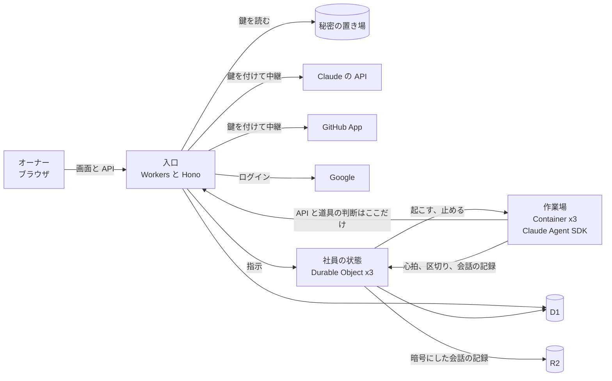

## Context

オーナー 1 人が使う管理室で、社員 3 人が毎日 8 時間動く。オーナーの情報と鍵を預かるので守りを高くし、費用は小さく保つ。サーバーは TypeScript、Cloudflare で完結、ログインは Google、という条件はオーナーが決めた。社員の動かし方は、3 つの案を比べてオーナーが案 B (作業場で Claude Agent SDK を動かす) に決めた。

## Goals / Non-Goals

**Goals:**

- Cloudflare の 1 つのアカウントで組み、外部とつなぐのは Google、GitHub、Claude の API の 3 つだけにする
- ルールの判断と鍵を入口の 1 か所に集める
- 社員の考える繰り返しは Claude Agent SDK に任せ、know-office で作るのは勤務、守り、記録、画面に絞る
- 後で AWS や Managed Agents などに移せる形にする。Cloudflare に依存する所を入口に、SDK に依存する所を作業場に集める

**Non-Goals:**

- 組織ごとに分ける仕組み
- Rust と Next.js。サーバーは入口の 1 つにまとめる
- 外からの見張り。外部との新しい連携になるので、要る時にオーナーに聞く

## Decisions

### 3 つの部分に分ける

| 部分 | 使う物 | 受け持つ事 |
| --- | --- | --- |
| 入口 | Cloudflare Workers。TypeScript と Hono。画面も同じ Worker から配る | ログインの確認、API、ルールの判断、合図を数えて止める、鍵を付けて Claude と GitHub へ中継する、画面の配信 |
| 社員の状態 | Cloudflare Durable Objects。社員 1 人に 1 つ | 勤務の時刻 (alarm)、仕事の山の写し、作業場を起こして止める、区切りの経過、勤怠を付ける |
| 作業場 | Cloudflare Containers。社員 1 人に 1 つ。勤務の間は起こし続ける | Claude Agent SDK が考える繰り返し、git、テスト、ビルド、エディタの補完 |



線の決まりは次のとおり。

1. 作業場から外への通信は、コンテナの外向きの通信の制限で入口だけに絞る。フックには頼らない
2. SDK は Claude の API を入口の中継 (`ANTHROPIC_BASE_URL`) 経由で呼ぶ。入口がトークンを数え、鍵を付け、止める時はここで切る
3. 作業場が持つのは、入口が仕事ごとに出す 1 時間の切符だけ。SDK は仕事 1 件ごとに呼び直し、その時に新しい切符を渡す。1 時間を超える仕事は、区切りごとに SDK を続きから呼び直して新しい切符を渡す
4. 道具を使う前のフック (PreToolUse) で入口のルールの判断を聞く。フックの設定と実行物は社員が書き換えられない所 (読むだけの場所) に置き、入口に届かない、5 秒のうちに答えが無い、エラーの時は断る
5. 作業場は D1 と R2 に直に触れない。SDK の会話の記録は区切りごとに社員の状態に渡し、社員の状態が暗号にして R2 に置く
6. Anthropic と GitHub App の鍵は入口だけが読む。会話の記録の暗号の鍵だけは、社員の状態も読む

### 社員の動かし方は案 B

| 案 | 形 | 結論 |
| --- | --- | --- |
| A. 自前の繰り返し | 社員の状態が Messages API を呼び、道具を使う時だけ作業場を起こす | 編集、文脈の圧縮、再開を自分で作るので作る量が多い。B で出口を絞れない時の予備 |
| B. Agent SDK を作業場で動かす | 作業場で SDK が繰り返しを回し、入口と社員の状態が監督する | 採る。Claude Code と同じ道具と圧縮を使え、守りは A と同じ強さで掛けられる |
| C. Managed Agents | Anthropic が繰り返しと作業場を持つ | 月 40 ドルほど増え、コードとオーナーの情報が Anthropic の作業場に置かれる。ベータ |

トークンの量はどの案もほぼ同じになる。社員の状態と記録の形は 3 案で同じにしておき、作業場の部分だけを差し替えられるようにする。

### 勤怠の根拠

社員の 1 日は次のとおり。

```mermaid
flowchart TD
  start[出勤: 9:00 に alarm で作業場を起こす] --> take[仕事を 1 つ取る<br/>山が空なら上司に頼む]
  take --> call[入口が 1 時間の切符を出し、SDK を呼ぶ]
  call --> work[考えて道具を使う<br/>使う前に入口が判断]
  work --> cp[区切り: 検査、コミット、PR、経過<br/>仕事を 1 行記録]
  cp --> q{終業の時刻?}
  q -->|まだ| take
  q -->|過ぎた| leave[退勤: 区切りまで最長 30 分待ち、作業場を止める]
```

社員の状態は繰り返しを直には見ないので、勤怠は次の 3 つから付ける。

1. 作業場から社員の状態への心拍。30 秒ごとに送り、90 秒届かなければ途切れたとする。途切れた間は働いた時間に入れない
2. フックから社員の状態に伝える区切り (検査が通る、コミット、プルリクエスト、経過を書き残す)
3. 入口が測る API の上限待ち。「待っていた時間」に入れる

### 記録の置き場

| 置き場 | 使う物 | 置く物 |
| --- | --- | --- |
| データベース | Cloudflare D1 | 下の表。今の状態を持つ表と、追記だけの表に分ける |
| 社員の状態の中 | Durable Objects の記憶 | 今の仕事と区切り、今日の勤務の予定、合図の数 (社員から見えない) |
| ファイルの置き場 | Cloudflare R2 | 暗号にした SDK の会話の記録、社員が作ったファイル、D1 の毎日の写し |
| 鍵の置き場 | Cloudflare の秘密の置き場 | Anthropic と GitHub App の鍵、暗号の鍵 |

D1 の表は次のとおり。追記だけの表は、更新と削除をトリガーで断る。どの行も office かサービスのどちらの物かを持つ。

| まとまり | 今の状態の表 | 追記だけの表 |
| --- | --- | --- |
| 人とログイン | `staff`、`sessions`、`passkeys` | `staff_prompts`、`login_attempts` |
| 仕事 | `nodes`、`reviews`、`approvals` | `node_events`、`messages`、`review_notes` |
| 勤務 | `daily_totals` (記録から作り直せる) | `work_entries`、`attendance`、`health_checks` |
| サービスと設定 | `services`、`extensions`、`notices` | `settings` (最新の行が今の値) |
| 守り | `github_deliveries` (通知の重複を防ぐ) | `stops`、`lessons`、`tool_calls` |
| 使った量と操作 | | `usage` (仕事ごと、読み直しの割引の当たりも)、`audit_log` |

- 時刻は協定世界時で持ち、勤怠の日付だけは日本時間の日を別の列に持つ
- 仕事の山の正本は D1 の `nodes`。社員の状態は写しを持ち、いつでも D1 から作り直せる
- `audit_log` は前の行のハッシュでつなぐ。順序が割れないよう、書き手は 1 つの Durable Object (記録係) にし、入口も社員の状態も記録係を通してしか書けない

### 画面と API をコンテナに置かない

入口の Workers では、git やテストのような別のプロセスを動かせず、ディスクも無く、メモリも 128MB までである。だから作業場にはコンテナが要る。一方で画面と API をコンテナに置くと、起きるのに数秒掛かり、常に起こしておく費用が増える。作業場は CPU 4 分の 1 個、メモリ 1GB (basic) から始め、足りなければ上げる。上げて月の費用が承認済みの額を超える時はオーナーに聞く。

### サーバーは TypeScript にそろえる

入口、社員の状態、作業場、画面を 1 つの言語で書く。Workers と Durable Objects は TypeScript がいちばん手厚く支えられていて、Claude Agent SDK も TypeScript で使える。仕事のほとんどは Claude の API、GitHub、データベースの返事を待つ時間なので、Rust の速さは効かない。ルールの判断と守りは共通の部品にし、入口と作業場の両方から同じ物を使う。操作の種類は型で並べ、`never` での網羅の確かめと lint の規則で、分岐の漏れを検査で落とす。画面とサーバーは同じ型をそのまま使う。

### 型安全は Drizzle と Zod

境目ごとに型を 1 か所で決め、残りはそこから作る。

| 境目 | 使う物 | 型の正本 |
| --- | --- | --- |
| D1 | Drizzle ORM (`drizzle-orm/d1`)。作り替えは drizzle-kit で SQL に起こし、wrangler で当てる | Drizzle の表の定義。行の型は `$inferSelect` と `$inferInsert` から取る |
| API | 入力は Zod と `@hono/zod-validator` で確かめる。出力は型だけで持ち、画面は Hono の RPC で同じ型を受ける | 入力は Zod の形 (型は `z.infer`)、出力は入口の返す値の型 |
| 作業場との受け渡し、設定、外からの通知 | Zod | 共通の部品 (`@know-office/core`) の Zod の形 |

- 外から来る物 (画面の入力、GitHub の通知、作業場の返事、D1 の JSON の列) は、使う前に必ず Zod で確かめる
- 追記だけの表は 2 重に守る。1 つ目は Drizzle の上に追記の関数だけを出し、書き換えと消す関数を作らない事。2 つ目は更新と削除を断るトリガーで、drizzle-kit は作らないので手書きの作り替え (`drizzle-kit generate --custom`) で足し、落ちるテストで在る事を確かめる
- `audit_log` の追記の関数は記録係の Durable Object の中だけに置き、入口と社員の状態は記録係を呼ぶ
- D1 は BEGIN と COMMIT の取引を使えないので、まとめて書く時は `db.batch()` を使う。`audit_log` の「最後の行を読んで次の行を書く」は記録係の中で 1 件ずつ順に行う
- Drizzle を選ぶのは、表の定義から行の型と作り替えの SQL が 1 か所で出るから。素の SQL では型と表がずれやすい

### 画面は Vite と React

画面は Vite、React、knowidea-ui で作り、事前に作った物を入口と同じ Worker から配る。画面ごとにコードを分け、3D とエディタは開いた時だけ読み込む。Next.js は、サーバー側の機能を使わない形になり、入口の Hono と役目が重なるので使わない。

Vite、Vitest、oxlint は VoidZero の道具で、すでに使っている。VoidZero の公開の仕組み Void は、Durable Objects と Containers が使えると確かめられず、社員の状態と作業場を載せられないので今は使わない。使えると分かったら、入口と画面を移せるか見直す。

### エディタは CodeMirror 6

スマートフォンでも動き、軽い。Monaco は携帯端末のブラウザに対応していない。補完と定義への移動は、作業場で動く TypeScript の解析の仕組みから取る。

### GitHub App を使う

オーナー個人の鍵ではなく、know-office という別の身分で動く。届く範囲を選んだリポジトリと操作に絞れ、鍵は使うたびに 1 時間で切れ、GitHub の画面で外せばすぐ使えなくなる。

### モデルの分け方

社長と見る役は Opus 5.5、作る役は Sonnet 5.5、仕分けや要約などの軽い仕事は Haiku 5.5 を使う。急がない仕事 (蒸留、記録の調べ、アイデア出し) は SDK を通さず、入口が一括処理の API で回す。

### 作る順

後の段が前の段の上に乗る順にし、各段の終わりで本番に公開して確かめる。

1. 土台: ログイン、鍵、作業場の出口の制限、追記の記録と公開の流れ。最初に Containers で外向きの通信を入口だけに絞れるかを確かめ、できなければ案 A に切り替える
2. 勤務: 社員の状態、勤務の時刻、勤怠の表。社員はまだ考えない
3. 止める: 合図を数えて止める、手で止める、切符の失効、止めた記録、再開。社員が考える前に置く
4. 考える: 作業場と Agent SDK、入口の中継とルールの判断、会話。社員は 1 人だけ
5. 仕事とレビュー: 木、GitHub App、社員と仕事の画面。ここで 3 人にする。4 までは社員が main に入れられない
6. 広げる: サービス、オフィスの 3D、拡張

### 公開

main ブランチに入ると GitHub Actions が検査し、画面、入口、コンテナをまとめて公開する。プルリクエストごとに試験用の環境 (Workers のプレビュー) を作る。プレビューの D1 と R2 は既定で本番と共有されるので、試験用の D1 と R2 を分けて結ぶ。Containers はプレビューで一部だけの対応なので、作業場が起きるかを作る順 1 で確かめ、起きなければ試験用の環境では作業場を起こさない。試験用の D1 と R2 を足しても月 15 ドルの範囲に収まる事も、作る順 1 で確かめる。本番も試験用の環境も、Access で守った URL だけで開く。Cloudflare が自動で付ける URL のうち、Access を通らない物は切る。

### 知らせのメール

Cloudflare の Email Service で、オーナーの確かめたアドレスだけに送る。確かめた宛先への送信は無料。送り元には Cloudflare に載せた独自のドメインが要り、今は持っていない。ドメインを新しく取る時は費用が増えるのでオーナーに聞く。ドメインが整うまでは、要件のメールの知らせ (monitoring と security) は画面の知らせだけで動かす。

## Risks / Trade-offs

- Containers で外向きの通信を入口だけに絞れない → 案 A に切り替える。社員の状態と記録の形は同じなので、作り直すのは作業場の部分だけ。切り替えで費用か外部連携が変わる時はオーナーに聞く
- 文書では、外への通信を切り (enableInternet: false)、HTTPS も入口の Worker に通す仕組みがある。作業場はその証明書 (/etc/cloudflare/certs/cloudflare-containers-ca.crt) を信じるように作り、作る順 1 で実際に確かめる
- 承認済みの費用は月 15 ドル前後。作業場を勤務の間ずっと起こすので、CPU を使い切ると月 19 ドルほどになりうる → 社員が考える段で実際に測り、超える時はオーナーの はい を得てから進める。作業場を大きくする時も同じ
- SDK の会話の記録にオーナーの情報が入りうる → 暗号にして R2 に置き、作業場は直に触れない
- Cloudflare 自体が止まると中の見張りも止まる → 今は受け入れ、要る時に外からの見張りをオーナーに聞く
- Containers は起きるのに数秒掛かる → 変更を読むだけの時は入口が GitHub から取って見せる
- 自動の守りが誤って止める → 狭く止め、誤って止めた回数を出し、基準を記録から直す
- 画面と入口を 1 つの Worker にまとめるので、片方の直しでも両方が公開される → 前の版に戻せる形で公開する

## Migration Plan

新しく作るので移す物は無い。公開した後は、前の版に戻せる形で入れる。

## Open Questions

残りは GitHub の Issue に 1 つ 1 件で置く。オフィスの 3D の部屋の雰囲気、色と細かい見た目、知らせのメールの送り方の 3 件。
